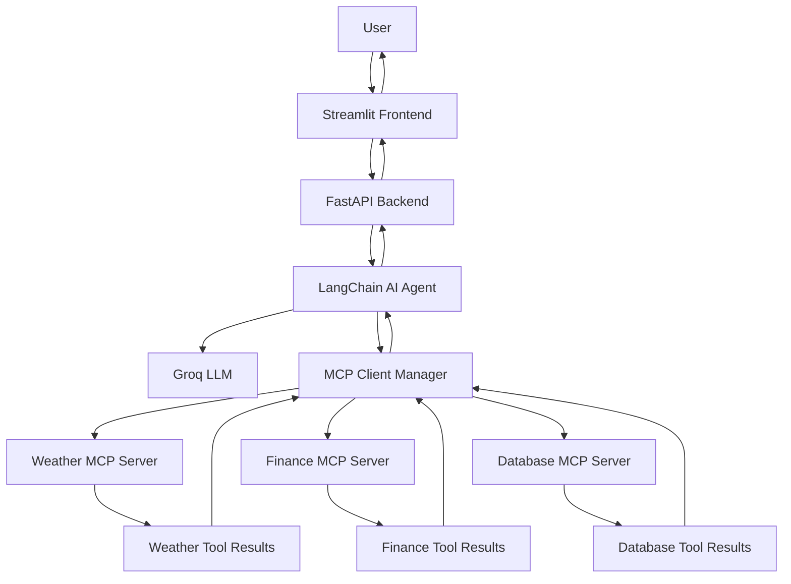

# Build an AI Agent Using MCP Tool Integration

An extensible AI-powered agent application that integrates multiple independent **Model Context Protocol (MCP) servers** with Large Language Models (LLMs) to execute tools, retrieve information, and respond to natural-language user queries.

The application uses a modular architecture built with Python, FastAPI, LangChain, MCP, and Streamlit. It demonstrates how AI agents can discover and interact with external services through a standardized tool-integration layer.

---

## 1. Project Overview

This project demonstrates the development of an AI agent capable of interacting with multiple independent MCP servers through a centralized MCP client manager.

Users can communicate with the agent using a Streamlit-based interface. The agent interprets requests, identifies relevant tools, invokes the appropriate MCP server, processes the returned results, and generates a natural-language response.

The architecture is designed to support modular development, independent service management, and future integration of additional MCP servers.

## 2. Key Features

- **AI-powered conversational interface:** Interact with the agent using natural language.
- **Multiple MCP server integration:** Connect independently running Weather, Finance, and Database MCP servers.
- **Dynamic tool discovery:** Discover available tools from connected MCP servers.
- **Intelligent tool selection:** Use an LLM to determine which tools are relevant to a user's request.
- **Weather information:** Retrieve weather information and forecast data for supported cities.
- **Financial operations:** Perform currency conversions and retrieve exchange rates.
- **Database operations:** Search customer records and retrieve customer details.
- **Conversation memory:** Maintain conversational context using LangGraph's in-memory checkpointing.
- **REST API:** Expose agent functionality through FastAPI endpoints.
- **Interactive frontend:** Provide a user-friendly interface using Streamlit.
- **Modular architecture:** Add new MCP servers and tools without redesigning the entire application.

## 3. System Architecture

The application follows a multiple-independent-MCP-server architecture.



### Request Processing Workflow

1. The user submits a natural-language query through the Streamlit interface.
2. Streamlit forwards the request to the FastAPI backend.
3. The LangChain agent processes the request using the configured LLM.
4. The agent identifies the appropriate tools based on the request.
5. The MCP client manager routes tool calls to the corresponding MCP server.
6. The MCP server executes the requested operation and returns its result.
7. The agent processes the tool output and generates a natural-language response.
8. FastAPI returns the response to Streamlit for display.

## 4. Technology Stack

| Technology | Purpose |
|---|---|
| Python | Core application development |
| MCP Python SDK | MCP client and server communication |
| LangChain | AI agent and tool orchestration |
| LangGraph | Conversation checkpointing and memory |
| Groq | LLM inference |
| FastAPI | Backend REST API |
| Streamlit | Interactive frontend |
| Pydantic | Data validation and structured schemas |
| SQLAlchemy | Database operations and ORM |
| SQLite | Local development database |
| Pytest | Unit and integration testing |
| HTTPX / Requests | HTTP communication |

## 5. MCP Server Modules

### 5.1 Weather MCP Server

**Port:** 8001

Provides weather-related tools.

Available tools:

- `get_weather` — Retrieve weather information for a supported city.
- `get_forecast` — Retrieve forecast information for a supported city.

### 5.2 Finance MCP Server

**Port:** 8002

Provides financial utility tools.

Available tools:

- `convert_currency` — Convert an amount between supported currencies.
- `get_exchange_rate` — Retrieve the exchange rate between two currencies.

### 5.3 Database MCP Server

**Port:** 8003

Provides customer database access through controlled MCP tools.

Available tools:

- `search_customers` — Search customer records using supported search fields.
- `get_customer` — Retrieve a customer record using its ID.

Database access is implemented using SQLAlchemy ORM rather than unrestricted SQL execution.

**Data note:** The current Weather and Finance implementations use mock data for demonstration purposes. They are not connected to live weather services or real-time financial market feeds. The database uses SQLite with sample customer records for local development.

## 6. Project Structure

```text
mcp-ai-agent/
│
├── app/
│   ├── main.py
│   │
│   ├── api/
│   │   ├── routes.py
│   │   └── schemas.py
│   │
│   ├── agent/
│   │   ├── engine.py
│   │   ├── prompts.py
│   │   └── memory.py
│   │
│   ├── mcp_client/
│   │   ├── manager.py
│   │   ├── adapter.py
│   │   ├── discovery.py
│   │   └── registry.py
│   │
│   ├── config/
│   │   └── config.py
│   │
│   ├── database/
│   │   ├── models.py
│   │   └── repository.py
│   │
│   └── services/
│       └── llm_service.py
│
├── frontend/
│   └── streamlit_app.py
│
├── mcp_servers/
│   ├── weather_server/
│   │   ├── server.py
│   │   ├── tools.py
│   │   └── schemas.py
│   │
│   ├── finance_server/
│   │   ├── server.py
│   │   ├── tools.py
│   │   └── schemas.py
│   │
│   └── database_server/
│       ├── server.py
│       ├── tools.py
│       ├── schemas.py
│       ├── database.py
│       └── models.py
│
├── tests/
│   ├── test_finance.py
│   ├── test_finance_mcp.py
│   ├── test_database.py
│   ├── test_database_mcp.py
│   └── test_end_to_end.py
│
├── .env
├── .env.example
├── .gitignore
├── requirements.txt
└── README.md
```

*Note: The structure represents the intended project organization. Retain only files that are present in the actual repository.*

## 7. Prerequisites

Before running the application, ensure the following are installed:

- Python 3.11 or later
- pip
- Git
- A Groq API key
- A code editor such as Visual Studio Code

## 8. Installation and Setup

### Step 1: Clone the repository

```bash
git clone <YOUR_GITHUB_REPOSITORY_URL>
cd mcp-ai-agent
```

### Step 2: Create a virtual environment

Windows:

```powershell
python -m venv venv
venv\Scripts\activate
```

Linux / macOS:

```bash
python -m venv venv
source venv/bin/activate
```

### Step 3: Install dependencies

```bash
pip install -r requirements.txt
```

### Step 4: Configure environment variables

Create a `.env` file in the project root.

```env
APP_NAME=MCP AI Agent
APP_ENV=development
DEBUG=True

LLM_PROVIDER=groq
GROQ_API_KEY=your_groq_api_key
GROQ_MODEL=llama-3.3-70b-versatile

OPENAI_API_KEY=
OPENAI_MODEL=gpt-4o-mini

WEATHER_MCP_URL=http://127.0.0.1:8001/mcp
FINANCE_MCP_URL=http://127.0.0.1:8002/mcp
DATABASE_MCP_URL=http://127.0.0.1:8003/mcp
```

Replace the API key placeholder with a valid Groq API key.

**Security:** Never commit `.env` or expose API keys in source code or public repositories.

## 9. Running the Application

The MCP servers, backend, and frontend run as separate processes during local development.

Open separate terminal windows from the project root.

### Terminal 1: Start Weather MCP Server

```bash
python -m mcp_servers.weather_server.server
```

### Terminal 2: Start Finance MCP Server

```bash
python -m mcp_servers.finance_server.server
```

### Terminal 3: Start Database MCP Server

```bash
python -m mcp_servers.database_server.server
```

### Terminal 4: Start FastAPI Backend

```bash
uvicorn app.main:app --host 127.0.0.1 --port 8000 --reload
```

FastAPI documentation:

http://127.0.0.1:8000/docs

### Terminal 5: Start Streamlit Frontend

```bash
python -m streamlit run frontend/streamlit_app.py
```

Open the application in your browser:

http://localhost:8501

Ensure all three MCP servers and the FastAPI backend are running before starting the frontend.

## 10. API Endpoints

The FastAPI backend exposes the following endpoints:

| Method | Endpoint | Description |
|---|---|---|
| GET | `/health` | Check backend and agent health |
| GET | `/api/tools` | Retrieve discovered agent tools |
| POST | `/api/chat` | Submit a message to the AI agent |

### Chat API Example

**Request:**

```http
POST /api/chat
Content-Type: application/json
```

```json
{
  "message": "What is the weather in Delhi?",
  "conversation_id": "demo-conversation-001"
}
```

**Response example:**

```json
{
  "response": "Here is the weather information for Delhi..."
}
```

The response text is illustrative. Actual output depends on the tool results and LLM response.

## 11. Example User Queries

Try the following queries in the Streamlit interface:

**Weather**
- What is the weather in Delhi?
- Give me the forecast for London for the next three days.

**Finance**
- Convert 100 USD into INR.
- What is the exchange rate from EUR to USD?

**Database**
- Search for customers in Delhi.
- Find customers with the name Rahul.

**Multi-tool interaction**
- Tell me the weather in London and convert 500 USD into INR.

**Conversation memory**
- My preferred city is Delhi. What is its weather?
- What about tomorrow?

The multi-tool and conversational examples demonstrate how the agent can select tools and maintain context across messages in a conversation.

## 12. Testing

The project includes unit tests, MCP integration tests, and end-to-end API tests.

Run the test suite:

```bash
python -m pytest tests/ -v
```

Run the end-to-end tests while the required application services are running:

```bash
python -m pytest tests/test_end_to_end.py -v -s
```

Testing covers:

- Finance currency conversion and exchange rates.
- Database search and customer retrieval.
- MCP client-server communication.
- Tool discovery.
- API health and tool endpoints.
- Weather, finance, and database agent requests.
- Multi-tool requests.
- Conversation context.

LLM-generated responses are non-deterministic, so semantic response quality should also be evaluated manually.

## 13. Scalability and Reliability Considerations

The modular architecture provides a foundation for future improvements.

Potential production enhancements include:

- Deploying MCP servers as independent services.
- Using PostgreSQL for persistent database storage.
- Using persistent LangGraph checkpointing for conversation history.
- Implementing authentication and role-based access control.
- Applying rate limits and request validation.
- Adding structured application logs and monitoring.
- Configuring service timeouts, retries, and health checks.
- Managing API keys through a secure secrets-management solution.
- Enforcing authorization and data minimization for customer information.
- Using TLS for external communication and private networking for internal services.

These measures should be implemented and verified before handling sensitive customer data or production workloads.

## 14. Deployment

The application is designed to support cloud deployment using independently hosted services.

The proposed deployment architecture includes:

- Streamlit as the public-facing frontend.
- FastAPI as the backend service.
- Independent Weather, Finance, and Database MCP services.
- Persistent storage for database records.
- Environment-based configuration for service URLs and API credentials.

Railway is the proposed cloud deployment platform.

Cloud deployment requires service-specific configuration, correct network binding, private service URLs, persistent storage, and securely configured environment variables.

## 15. Current Project Status

| Component | Status |
|---|---|
| Weather MCP Server | Implemented and tested |
| Finance MCP Server | Implemented and tested |
| Database MCP Server | Implemented and tested |
| MCP Client Manager | Implemented |
| Dynamic Tool Discovery | Implemented |
| LangChain AI Agent | Implemented |
| Conversation Memory | Implemented using in-memory checkpointing |
| FastAPI Backend | Implemented and tested |
| Streamlit Frontend | Implemented and tested |
| End-to-End Testing | Completed |
| Public Cloud Deployment | Planned / In progress |
| Production Authentication | Future enhancement |
| Persistent Conversation Storage | Future enhancement |

## 16. Future Enhancements

The architecture can be extended with:

1. Integration of live weather APIs.
2. Integration of live exchange-rate providers.
3. Additional MCP servers for external business services.
4. Persistent conversation history.
5. User authentication and authorization.
6. Advanced observability and monitoring.
7. Docker-based deployment and orchestration.
8. Production-grade database and cloud infrastructure.

## 17. Conclusion

This project demonstrates how Model Context Protocol can be used to build modular, tool-enabled AI agents.

By combining LangChain, MCP, Groq, FastAPI, and Streamlit, the application provides a practical example of how an LLM can discover and interact with multiple independent services through a standardized integration architecture.

The modular design provides a foundation for expanding the system with additional tools, services, and enterprise capabilities.

---

**Project:** Build an AI Agent Using MCP Tool Integration  
**Primary Language:** Python  
**Architecture:** Multiple Independent MCP Servers  
**LLM Provider:** Groq  
**Backend:** FastAPI  
**Frontend:** Streamlit  
**Protocol:** Model Context Protocol (MCP)